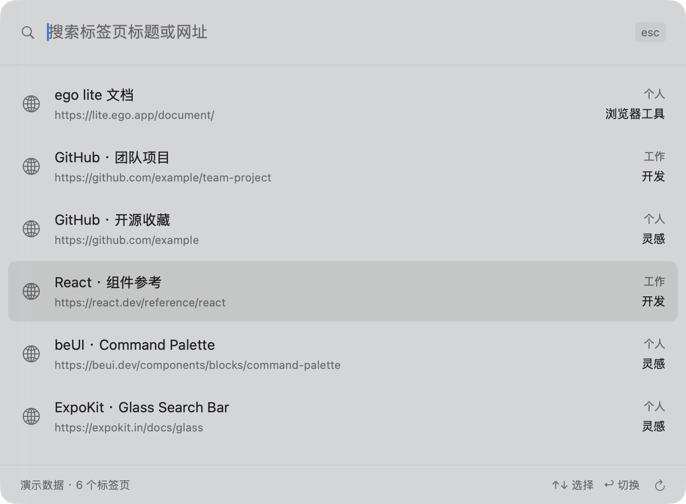
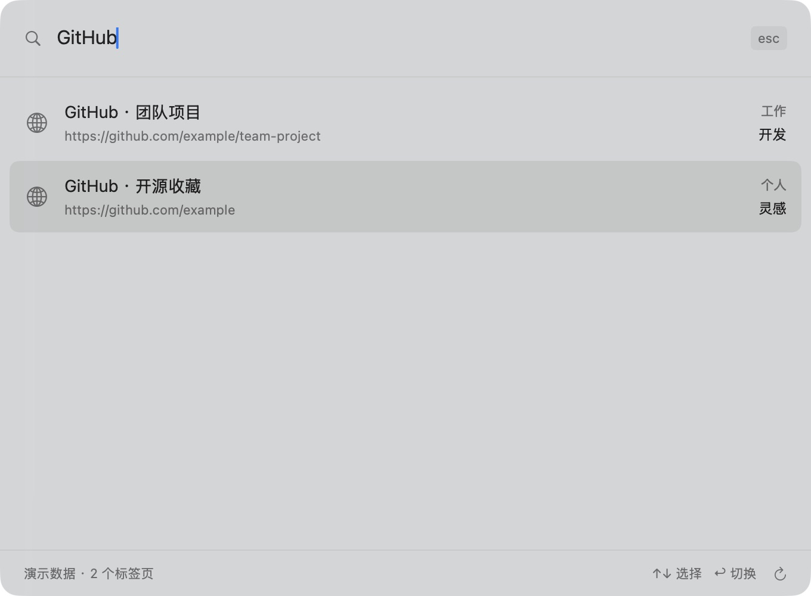

# Ego Tab Search · ego lite 拓展

一个原生 macOS 菜单栏工具。按 **⌘⇧K**，跨 profile、跨 space 搜索已有标签页，并切换到原来的页面。MIT 开源，基于本机 ego-browser/CDP 与 SwiftUI 构建的社区拓展。

当同一个网站在不同账号里都打开、标签页分散在多个 space 时，可以直接搜索标题或网址。每条结果都显示所属 profile 和空间，省去先猜账号、再逐个空间翻找的步骤。

- 一个快捷键唤起毛玻璃搜索面板，中文标题和完整网址都能搜索。
- 同时展示多个 profile、space 中的结果，相同名字可以并存。
- ↑↓ 选择、Enter 激活原标签页、Esc 关闭、⌘R 刷新。
- 标签清单通过本机进程管道读取，查询留在本地。

[下载安装包](https://airi-downloads.pages.dev/?platform=macos) · [GitHub Releases](https://github.com/111pointer111/ego-lite-tab-search/releases)

## 功能展示

下图均由实际原生界面使用演示数据截取。



搜索相同的网站时，可以区分工作账号与个人账号，并选择对应空间中的原标签。



## 安装与使用

1. 安装 [ego lite](https://lite.ego.app/)，完成首次初始化，并确认终端可以运行 `ego-browser skill`。本项目在 ego lite 0.6.2.9 上完成了浏览器集成测试。
2. 从下载页的 **Mac 电脑** 栏或 GitHub Releases 下载 Apple Silicon DMG。
3. 打开 DMG，将 **Ego Tab Search.app** 拖入 **Applications**，然后启动应用。
4. 按 **⌘⇧K**，输入标签页标题或网址。每条结果右侧显示 profile 和 space，按 Enter 或点击结果即可切换。

需要 Apple Silicon Mac、macOS 13 及以上，以及 ego lite 安装的 `~/.local/bin/ego-browser`。应用驻留菜单栏，退出入口在菜单中。快捷键冲突时可从菜单栏打开。

当前提供 ad-hoc 签名的公开预览包，尚未使用 Developer ID 签名或完成 Apple 公证。macOS 可能要求首次打开时确认来源。请核对 Release 提供的 SHA-256，再按系统“隐私与安全性”里的提示自行确认。

```sh
shasum -a 256 Ego-Tab-Search-1.0.0-arm64.dmg
```

下载列表的更新由 CI 完成，设备上的应用安装由用户确认。

## 空间归属

底层按浏览器窗口 ID、context ID 和 space ID 区分身份，允许 profile、space 和标签页同名。利用整个标签清单进行一一匹配，只有唯一解时自动显示 space 名称。

遇到完全相同的标签组合时，行右侧会显示“选择所属空间”。先点击该标签确认所在空间，再回到搜索，在菜单中选择它。这个选择按窗口与浏览器 context 保存。浏览器重启后会重新校验。无候选的结果可等待标签状态稳定后按 ⌘R 刷新。

未命名的现有空间显示为“未命名空间 · #ID”。建议创建空间时使用简短的任务名称，重复名称仍可正常使用。

标签数据只通过本机进程管道传递，查询与地址不写入配置。显示的网址隐藏用户信息、查询参数和片段，搜索仍支持完整网址。工具运行期间使用名为“标签搜索工具 · 应用标识”的独立空间，退出时关闭该工具空间。

## 构建和验证

```sh
zsh build.sh
node --test bridge/*.test.mjs
node --check bridge/runtime.mjs
```

Swift 编译器使用本机 Xcode Command Line Tools，无第三方运行依赖。源代码位于 `Sources/` 和 `bridge/`。界面参考与授权见 [THIRD_PARTY.md](THIRD_PARTY.md)。

## CI/CD 与发布

推送到 `main` 或创建 PR 时，GitHub Actions 会执行 JavaScript 语法检查、12 项回归测试、Swift 类型检查、应用构建与签名校验。图标和开源授权随构建一起打包。

发布新版本时，修改 `Info.plist` 的版本与构建号并提交，再推送匹配的轻量版本标签，例如 `v1.0.1`。CI 会确认标签版本与源码身份，构建 DMG、`desktop-release.json` 和 `SHA256SUMS.txt`，再创建 GitHub 预览 Release。

下载站每半小时检查公开 Release，核对标签、main 分支来源、版本、DMG 大小与摘要，镜像到 R2 并完整读回校验后，更新 Mac 下载目录。Cloudflare Pages 随目录提交自动部署。失败时保留已发布的下载链接。

公开演示截图使用 `docs/demo-tabs.json` 中的合成资料，与真实浏览器数据分开。最低系统编译目标为 macOS 13，真实界面与浏览器集成在开发机完成；暗色模式、VoiceOver 和 macOS 13 真机尚未实测。

## 开源与设计来源

采用 [MIT License](LICENSE)。命令面板结构参考 beUI Command Palette，毛玻璃材质参考 ExpoKit Glass，应用使用 macOS 系统模糊材质。beUI 的授权文本保留在源码和安装包中。详情见 [THIRD_PARTY.md](THIRD_PARTY.md)。
